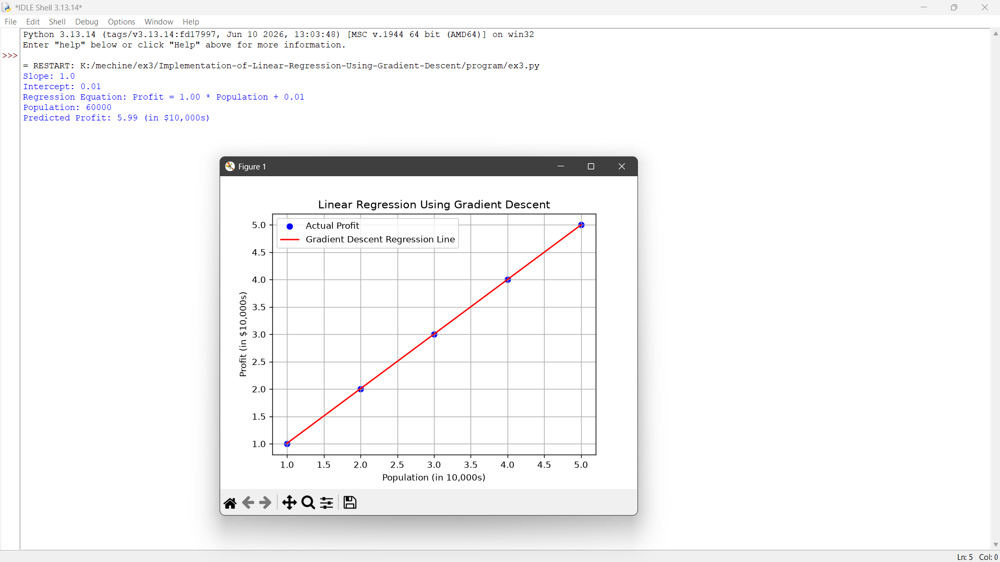

# Implementation-of-Linear-Regression-Using-Gradient-Descent

## AIM:
To write a program to predict the profit of a city using the linear regression model with gradient descent.

## Equipments Required:
1. Hardware – PCs
2. Anaconda – Python 3.7 Installation / Jupyter notebook

## Algorithm
1. Import the required libraries and initialize the population and profit datasets.
2. Initialize the slope and intercept to zero and set the learning rate and number of iterations.
3. Calculate the predicted profit and cost function, then update the slope and intercept using Gradient Descent.
4. Predict the profit for a given population and plot the actual data points and the regression line.

## Program:
```
import numpy as np
import matplotlib.pyplot as plt

# Population of cities (in 10,000s)
X = np.array([1, 2, 3, 4, 5], dtype=float)

# Profit of cities (in $10,000s)
Y = np.array([1, 2, 3, 4, 5], dtype=float)

# Initialize parameters
m = 0.0
b = 0.0

# Learning rate and iterations
learning_rate = 0.01
iterations = 1000
n = len(X)

# Gradient Descent
for i in range(iterations):
    Y_pred = m * X + b

    dm = (-2 / n) * np.sum(X * (Y - Y_pred))
    db = (-2 / n) * np.sum(Y - Y_pred)

    m = m - learning_rate * dm
    b = b - learning_rate * db

# Display results
print("Slope:", round(m, 2))
print("Intercept:", round(b, 2))
print("Regression Equation: Profit = {:.2f} * Population + {:.2f}".format(m, b))

# Predict profit for a city with population 6 (in 10,000s)
population = 6
predicted_profit = m * population + b

print("Population:", population * 10000)
print("Predicted Profit:", round(predicted_profit, 2), "(in $10,000s)")

# Plot actual data and regression line
Y_pred = m * X + b

plt.scatter(X, Y, color="blue", label="Actual Profit")
plt.plot(X, Y_pred, color="red", label="Gradient Descent Regression Line")

plt.xlabel("Population (in 10,000s)")
plt.ylabel("Profit (in $10,000s)")
plt.title("Linear Regression Using Gradient Descent")
plt.legend()
plt.grid(True)
plt.show()

```

## Output:



## Result:
Thus the program to implement the linear regression using gradient descent is written and verified using python programming.